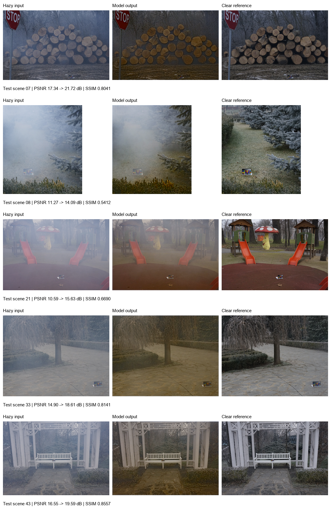
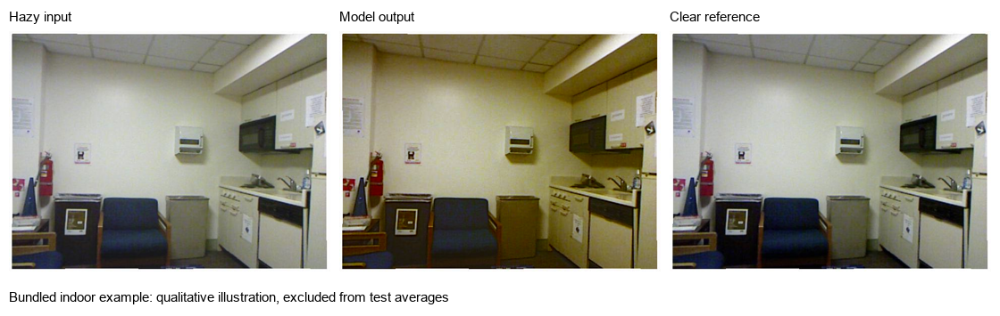
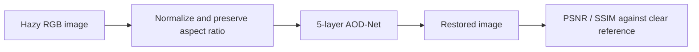
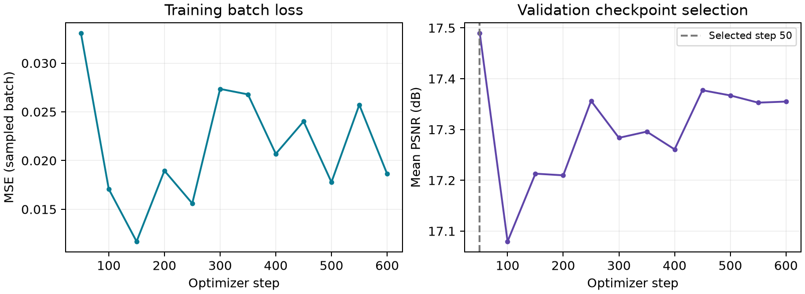

# Image Dehazing with AOD-Net

A compact PyTorch project that restores haze-degraded images and measures the result against a matched clear reference. It includes training, validation-based checkpoint selection, image inference, PSNR/SSIM evaluation, automated tests, and visual comparisons.

**Model:** 5-layer AOD-Net | **Parameters:** 1,761 | **Runtime:** CPU | **Evaluation date:** 20 October 2026

## Results

Measured on **5 held-out O-HAZE scenes**, using a custom **35 training / 5 validation / 5 test** scene split. Images preserve their aspect ratio and are resized to a maximum side of **384 pixels**.

| Mean RGB metric (higher is better) | Hazy input | Model output | Difference |
|---|---:|---:|---:|
| PSNR | 14.13 dB | **17.93 dB** | **+3.80 dB** |
| SSIM | 0.6650 | **0.7368** | **+0.0719** |

The model improved both metrics on all five test scenes. These are small-scale educational results, **not an official O-HAZE challenge score**. The test scenes were excluded from this model's training and checkpoint selection. The network was trained from scratch; no pretrained weights were used.

[Per-scene results](reports/per_scene.csv) | [Full evaluation protocol](reports/evaluation.md) | [Machine-readable results](reports/test_results.json)

## Image comparisons

All five test scenes are shown below, in scene-ID order. Each row contains **hazy input -> model output -> clear reference**. No test examples are omitted.



### Bundled indoor example

This is the same bundled hazy/clear scene supplied with the academic project, processed by the included model. It is a separate qualitative example and does not contribute to the O-HAZE averages. Performance varies with scene and haze conditions; [its individual scores](reports/bundled_sample.json) are included.



## How it works

1. Pair each hazy image with its clear reference and assign complete scenes to a fixed split.
2. Normalize RGB values to [0, 1]. Resize without stretching; sample paired 96 x 96 training crops with matching flips.
3. Train the 5-layer AOD-Net using mean squared error, Adam and a cosine learning-rate schedule.
4. Select the saved checkpoint with the highest mean validation PSNR.
5. Evaluate that checkpoint on the reserved test scenes and export per-scene metrics and comparison figures.



## Training and evaluation

The recorded run used **600 optimizer steps**, batch size **8**, crop size **96**, initial learning rate **0.001**, random seed **2026**, and **2 CPU threads**. Validation ran every 50 steps. The selected checkpoint is step **50**, chosen before test evaluation. Later steps did not improve validation PSNR, so the last checkpoint was not used for reporting.



The left plot shows sampled training-batch MSE, not an epoch average. Logs, settings, checkpoint selection and file hashes are retained under [artifacts/aodnet](artifacts/aodnet) and [reports](reports).

## Reproduce the results

Run these commands from the repository root using **Python 3.12**. A GPU is not required. The official dataset download is approximately **547 MiB**; raw dataset files are ignored by Git.

```powershell
python -m venv .venv
.venv\Scripts\Activate.ps1
python -m pip install torch==2.14.1 --index-url https://download.pytorch.org/whl/cpu
python -m pip install -r requirements-report.txt

# Download the official paired images and verify archive CRCs.
python scripts/download_data.py

# Create the fixed 35/5/5 scene split, with per-image SHA-256 hashes.
python -m dehaze prepare --seed 2026

# Reproduce training and validation-based checkpoint selection.
python -m dehaze train --steps 600 --seed 2026 --batch-size 8 --patch 96 --max-side 384 --validate-every 50 --threads 2

# Evaluate the selected checkpoint and regenerate visual reports.
python -m dehaze evaluate --max-side 384 --threads 2
python scripts/check.py
python scripts/report.py
```

On Linux/macOS, activate with `source .venv/bin/activate`. To evaluate the supplied checkpoint without retraining, complete setup, download the dataset, and run only `prepare`, `evaluate`, and `scripts/report.py`. Small floating-point differences can occur across platforms or library builds.

### Try an image

```powershell
python -m dehaze infer --input assets/samples/hazy.jpg --output outputs/restored.png
```

### Run the tests

```powershell
python -m unittest discover -s tests -v
```

**Local result: 10 tests passed**, covering scene separation, missing pairs, paired augmentation, known metric values, checkpoint round trips, model shape/parameter checks, and a real optimizer update. [Recorded test run](reports/tests.txt). GitHub Actions is configured to run the tests on pushes and pull requests; its remote status is separate from this local result.

## Dataset and metric conventions

- **Dataset:** [O-HAZE, Ancuti et al., CVPR Workshops 2018](https://data.vision.ee.ethz.ch/cvl/ntire18/o-haze/), 45 real outdoor hazy/clear scene pairs.
- **PSNR:** computed from per-image RGB mean squared error over values in [0, 1], then averaged across test scenes. No image crop is used for PSNR.
- **SSIM:** 11 x 11 Gaussian window, sigma 1.5, population covariance, K1=0.01, K2=0.03, RGB channel average. The valid window excludes a 5-pixel boundary.
- Both input and output are compared with the same resized clear reference. The output is clipped to [0, 1].
- This project uses a custom scene split and reduced resolution. Compare numbers only when dataset, split, resolution and metric definitions match.

## Scope

This is a small supervised academic/portfolio experiment, not a production image-enhancement service or a new dehazing architecture. Five held-out scenes do not establish general performance. The model can alter brightness, color or detail, and the indoor example is outside the outdoor training distribution.

## Repository layout

```text
dehaze/                 Model, data, metrics, training, evaluation and inference
scripts/                Dataset download and report generation
tests/                  Automated checks
artifacts/aodnet/       Selected checkpoint, configuration and training history
reports/                Split manifest, per-scene results, tests and figures
assets/samples/         Bundled example images
datasets/               Downloaded official data (not committed)
```

## Attribution

Architecture: **Boyi Li et al., AOD-Net: All-in-One Dehazing Network (ICCV 2017)**. Implementation reference: [walsvid/AOD-Net-PyTorch](https://github.com/walsvid/AOD-Net-PyTorch). This project applies and evaluates an existing architecture; it does not claim architectural novelty.

Dataset citation: Codruta O. Ancuti, Cosmin Ancuti, Radu Timofte and Christophe De Vleeschouwer, **O-HAZE: A Dehazing Benchmark with Real Hazy and Haze-Free Outdoor Images**, CVPR Workshops 2018. The dataset remains attributed to its creators and is downloaded from their official host.
